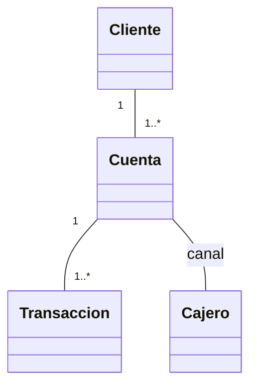

# Modelo de Dominio

## Entidades y relaciones




## Modelo de contexto (base para OCL)

### Context: Cuenta

```text
self.saldo: real
self.activa: logico
self.limiteDiario: entero
self.retiradoHoy: fecha
```

### Context: Cliente

```text
self.autenticado: logico
```

### Context: Cajero

```text
self.efectivoDisponible: real
self.operativo: logico
self.denominacionMinima: entero
```

### Context: Transaccion

```text
self.tipo: {RETIRO}
self.monto: real
self.estado: {EXITOSA, RECHAZADA}
```

Los montos `cast(entero, monto)` (unidad mínima) para evitar errores de redondeo.

